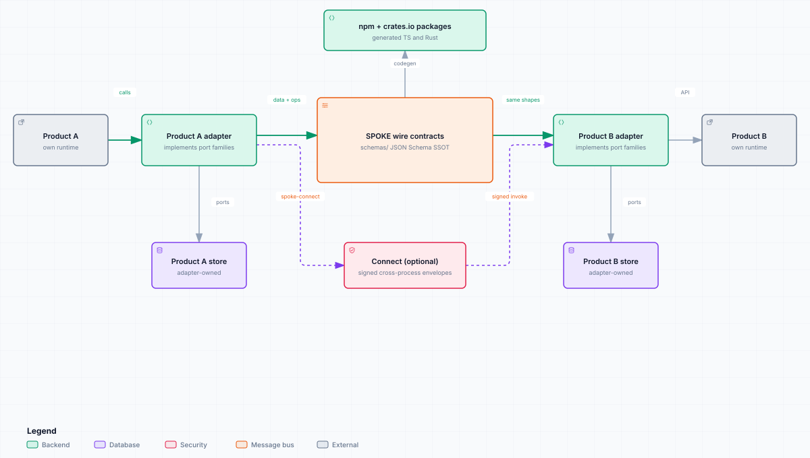

# SPOKE

[](https://github.com/42ch-dev/spoke/actions/workflows/ci.yml)
[](LICENSE)
[](https://github.com/42ch-dev/spoke/releases)
[](https://github.com/42ch-dev/spoke/commits/main)
[](https://www.greptile.com/?utm_source=oss_badge&utm_medium=readme&utm_campaign=greptile_for_open_source)

[中文](README_CN.md) · [Concepts](CONCEPTS.md) · [Contributing](CONTRIBUTING.md) · [Documentation](https://spoke.42ch.dev/)

**SPOKE** is a protocol for narrative knowledge. Two products that both store characters, scenes, timelines or world facts can exchange them through one shared set of JSON contracts instead of inventing a private format each time.

The repository is the single source of truth: hand-written JSON Schemas, generated TypeScript and Rust types, and a pure operations library that applies the protocol rules. Your product keeps its own storage, ranking, retrieval and transport.

<picture>
  <source media="(prefers-color-scheme: dark)" srcset="docs/public/diagrams/spoke-overview.dark.svg">
  
</picture>

## What you get

- **One wire dialect** — 11 data objects and 5 baseline op families, with 114 committed JSON Schemas as the source of truth.
- **Typed clients on both sides** — `@42ch/spoke-schemas` on npm and `spoke-schemas` on crates.io, generated from the same schemas.
- **Protocol behavior as a library** — `@42ch/spoke-operations` / `spoke-operations` ship pure validators, capability-sliced adapter ports, and `orchestrate*` entrypoints.
- **Optional capability families** — computable body state, forks, cognition, cross-product modules, extraction, ownership, memory, and signed cross-process connect.
- **A working reference** — `ToyWorldAdapter` in [`fixtures/toy-world/`](fixtures/toy-world/) passes the conformance harness in TypeScript and Rust.

## Install

### TypeScript

```bash
pnpm add @42ch/spoke-schemas @42ch/spoke-operations
```

```ts
import type { KnowledgeEntry, PromoteRequest } from "@42ch/spoke-schemas";
import { orchestratePromote, type BaselineAdapter } from "@42ch/spoke-operations";
```

### Rust

```bash
cargo add spoke-schemas spoke-operations
```

```rust
use spoke_operations::{orchestrate_promote, BaselineAdapter};
use spoke_operations::spoke_schemas::{PromoteRequest, UpsertRequest};
```

### Connect (optional)

For signed cross-process sessions there is `@42ch/spoke-connect` on npm and `spoke-connect` on crates.io. Native bindings ship for C#, Kotlin, Swift, Go, Python, and C/C++.

```bash
pnpm add @42ch/spoke-connect
cargo add spoke-connect
```

Pin every package to the same SemVer. Install details and binding channels: [Package quick-start](https://spoke.42ch.dev/packages/quick-start).

## A first promote

Implement the port families your capabilities require on one adapter type, then call the matching orchestrator.

```ts
import type { KnowledgeEntry, PromoteRequest } from "@42ch/spoke-schemas";
import { orchestratePromote, type BaselineAdapter } from "@42ch/spoke-operations";

declare const adapter: BaselineAdapter;

const candidate: KnowledgeEntry = {
  schema_version: 1,
  entry_id: "kb_01",
  entry_type: "character",
  canonical_name: "Aria",
  status: "provisional",
  body: { summary: "A reluctant scout." },
  extensions: {},
};

const request: PromoteRequest = { candidate };
const result = await orchestratePromote(adapter, request);

if (result.ok) {
  // Confirmed entry persisted through the adapter's OCC ports.
} else {
  console.error(result.code, result.message);
}
```

The library loads the stored entry, runs the terminal-status and revision gates, applies promote acceptance, and writes through `KnowledgeEntryPort` with `expectedBaseRevision`. The adapter owns the atomic compare-and-put.

Step by step: [Implement an adapter](https://spoke.42ch.dev/how-to/implement-adapter) and [Orchestrate operations](https://spoke.42ch.dev/how-to/orchestrate-ops).

## Packages

All published packages share one lockstep SemVer.

| Package | Registry | Role |
|---------|----------|------|
| [`@42ch/spoke-schemas`](https://www.npmjs.com/package/@42ch/spoke-schemas) | npm | Generated TypeScript wire types |
| [`@42ch/spoke-operations`](https://www.npmjs.com/package/@42ch/spoke-operations) | npm | Pure helpers, adapter ports, orchestration |
| [`@42ch/spoke-connect`](https://www.npmjs.com/package/@42ch/spoke-connect) | npm | Language-native connect client over WebSocket |
| [`spoke-schemas`](https://crates.io/crates/spoke-schemas) | crates.io | Generated Rust wire types |
| [`spoke-operations`](https://crates.io/crates/spoke-operations) | crates.io | Pure helpers, adapter ports, orchestration |
| [`spoke-connect`](https://crates.io/crates/spoke-connect) | crates.io | Rust connect reference with libp2p and the uniffi binding surface |

## Capabilities

`spoke-baseline` covers the shared data and ops shapes. Everything else is opted in.

| Flag | What it adds |
|------|--------------|
| `l2-computable` | `body.state` / `body.computable`, `project` and `compute` ops |
| `l5-fork` | branch metadata on `TimelineEvent` and `Scope.fork_id` |
| `spoke-cognition` | attributable belief, epistemic and perception records, selection, derivative `MindState` |
| `narrative-modules` | a capability-flagged `modules` bag for cross-product dialects |
| `ke-extraction` | `extract` candidates from referenced source material |
| `ke-ownership` | owner and disclosure fields plus `Scope.viewpoint` |
| `spoke-connect` | signed hello, session, invoke and auth envelopes |
| `spoke-memory` | 13 memory models and 33 `memory.*` ops, with reflection and transfer sub-flags |

Capability reference: [Protocol](https://spoke.42ch.dev/reference/protocol), [Concepts](https://spoke.42ch.dev/explanation/concepts).

## Documentation

The site is organised by job:

| You want to | Read |
|-------------|------|
| Install and persist a first entry | [Install and first entry](https://spoke.42ch.dev/tutorials/install-and-first-entry) |
| Build an adapter | [Implement an adapter](https://spoke.42ch.dev/how-to/implement-adapter) |
| Check field names and required sets | [Data model](https://spoke.42ch.dev/reference/data-model) |
| Write or read an op envelope | [Ops wire](https://spoke.42ch.dev/reference/ops) |
| Serve per-subject memory | [Memory](https://spoke.42ch.dev/reference/memory) |
| Open a cross-process session | [Connect](https://spoke.42ch.dev/reference/connect) |
| Understand the layer model | [Concepts](https://spoke.42ch.dev/explanation/concepts) |
| Publish ontology vocabulary | [Domain profiles](https://spoke.42ch.dev/explanation/domain-profiles) |

Agents and code assistants: [docs/agents.md](docs/agents.md) is the reading contract, and [llms.txt](https://spoke.42ch.dev/llms.txt) / [llms-full.txt](https://spoke.42ch.dev/llms-full.txt) are the machine-readable indexes.

## Versioning

npm and crates.io share the same version. An annotated git tag `vX.Y.Z` matches it.

```bash
pnpm add @42ch/spoke-schemas@X.Y.Z @42ch/spoke-operations@X.Y.Z
cargo add spoke-schemas@X.Y.Z spoke-operations@X.Y.Z
```

Release notes: [CHANGELOG.md](CHANGELOG.md) and [GitHub Releases](https://github.com/42ch-dev/spoke/releases). Pinning guide: [Version and release](https://spoke.42ch.dev/release/versioning).

## Contributing

Local development, CI gates and the release procedure: [CONTRIBUTING.md](CONTRIBUTING.md). Repository conventions for agents: [AGENTS.md](AGENTS.md).
