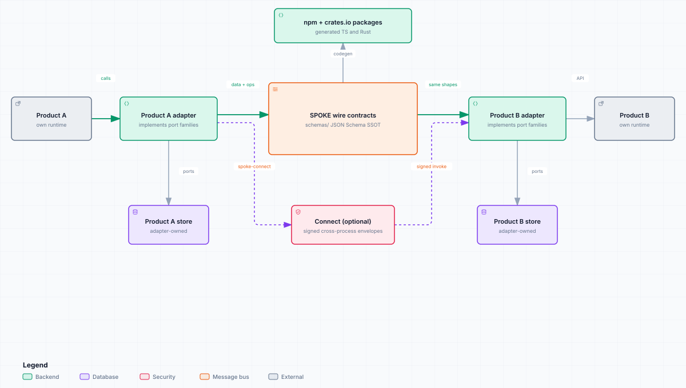

# SPOKE

[](https://github.com/42ch-dev/spoke/actions/workflows/ci.yml)
[](LICENSE)
[](https://github.com/42ch-dev/spoke/releases)
[](https://github.com/42ch-dev/spoke/commits/main)
[](https://www.greptile.com/?utm_source=oss_badge&utm_medium=readme&utm_campaign=greptile_for_open_source)

[English](README.md) · [核心概念](CONCEPTS.md) · [贡献指南](CONTRIBUTING.md) · [文档站点](https://spoke.42ch.dev/zh/)

**SPOKE** 是一套面向叙事知识的协议。两个都存储角色、场景、时间线或世界事实的产品，可以通过同一组 JSON 契约交换数据，不必每次另造私有格式。

本仓库是唯一事实来源：手写的 JSON Schema、由其生成的 TypeScript 与 Rust 类型，以及一份执行协议规则的纯函数操作库。存储、排序、检索与传输仍由你的产品负责。

<picture>
  <source media="(prefers-color-scheme: dark)" srcset="docs/public/diagrams/spoke-overview.dark.svg">
  
</picture>

## 你能得到什么

- **一套线上方言** —— 11 个数据对象与 5 个基线 op 族，以 114 个已提交的 JSON Schema 为唯一事实来源。
- **两侧的类型化客户端** —— npm 上的 `@42ch/spoke-schemas` 与 crates.io 上的 `spoke-schemas`，由同一份 schema 生成。
- **作为库的协议行为** —— `@42ch/spoke-operations` / `spoke-operations` 提供纯校验器、按能力切片的 adapter port，以及 `orchestrate*` 入口。
- **可选能力族** —— 可计算 body 状态、分支、认知、跨产品模块、抽取、归属、记忆，以及签名的跨进程 connect。
- **可运行参考实现** —— [`fixtures/toy-world/`](fixtures/toy-world/) 中的 `ToyWorldAdapter` 通过 TypeScript 与 Rust 一致性测试。

## 安装

### TypeScript

```bash
pnpm add @42ch/spoke-schemas @42ch/spoke-operations
```

```ts
import type { KnowledgeEntry, PromoteRequest } from "@42ch/spoke-schemas";
import { orchestratePromote, type BaselineAdapter } from "@42ch/spoke-operations";
```

### Rust

```bash
cargo add spoke-schemas spoke-operations
```

```rust
use spoke_operations::{orchestrate_promote, BaselineAdapter};
use spoke_operations::spoke_schemas::{PromoteRequest, UpsertRequest};
```

### Connect（可选）

需要签名的跨进程会话时，使用 npm 的 `@42ch/spoke-connect` 与 crates.io 的 `spoke-connect`。原生绑定覆盖 C#、Kotlin、Swift、Go、Python 与 C/C++。

```bash
pnpm add @42ch/spoke-connect
cargo add spoke-connect
```

所有包固定到同一 SemVer。安装细节与绑定渠道：[软件包快速开始](https://spoke.42ch.dev/zh/packages/quick-start)。

## 第一次 promote

在一个 adapter 类型上实现所需的能力 port 族，然后调用对应的编排器。

```ts
import type { KnowledgeEntry, PromoteRequest } from "@42ch/spoke-schemas";
import { orchestratePromote, type BaselineAdapter } from "@42ch/spoke-operations";

declare const adapter: BaselineAdapter;

const candidate: KnowledgeEntry = {
  schema_version: 1,
  entry_id: "kb_01",
  entry_type: "character",
  canonical_name: "Aria",
  status: "provisional",
  body: { summary: "A reluctant scout." },
  extensions: {},
};

const request: PromoteRequest = { candidate };
const result = await orchestratePromote(adapter, request);

if (result.ok) {
  // 已确认条目通过 adapter 的 OCC port 持久化。
} else {
  console.error(result.code, result.message);
}
```

库会加载已存条目、运行终态与 revision 门控、执行 promote 准入，并通过 `KnowledgeEntryPort` 携带 `expectedBaseRevision` 写入。原子 compare-and-put 由 adapter 负责。

分步说明：[实现 Adapter](https://spoke.42ch.dev/zh/how-to/implement-adapter) 与 [编排操作](https://spoke.42ch.dev/zh/how-to/orchestrate-ops)。

## 软件包

所有已发布包共享同一个锁步 SemVer。

| 包 | 注册表 | 角色 |
|----|--------|------|
| [`@42ch/spoke-schemas`](https://www.npmjs.com/package/@42ch/spoke-schemas) | npm | 生成的 TypeScript 线上类型 |
| [`@42ch/spoke-operations`](https://www.npmjs.com/package/@42ch/spoke-operations) | npm | 纯辅助函数、adapter port、编排 |
| [`@42ch/spoke-connect`](https://www.npmjs.com/package/@42ch/spoke-connect) | npm | 基于 WebSocket 的语言原生 connect 客户端 |
| [`spoke-schemas`](https://crates.io/crates/spoke-schemas) | crates.io | 生成的 Rust 线上类型 |
| [`spoke-operations`](https://crates.io/crates/spoke-operations) | crates.io | 纯辅助函数、adapter port、编排 |
| [`spoke-connect`](https://crates.io/crates/spoke-connect) | crates.io | Rust connect 参考实现，含 libp2p 与 uniffi 绑定面 |

## 能力标志

`spoke-baseline` 覆盖共享的数据与 ops 形状。其余能力按需启用。

| 标志 | 增加的内容 |
|------|-----------|
| `l2-computable` | `body.state` / `body.computable`、`project` 与 `compute` ops |
| `l5-fork` | `TimelineEvent` 上的分支元数据与 `Scope.fork_id` |
| `spoke-cognition` | 可归因的信念、认知与感知记录、选择、派生的 `MindState` |
| `narrative-modules` | 承载跨产品方言的能力标志 `modules` 字段袋 |
| `ke-extraction` | 从引用源材料抽取 `extract` 候选 |
| `ke-ownership` | owner 与 disclosure 字段，以及 `Scope.viewpoint` |
| `spoke-connect` | 签名 hello、会话、invoke 与认证信封 |
| `spoke-memory` | 13 个记忆模型与 33 个 `memory.*` ops，含 reflection 与 transfer 子标志 |

能力参考：[协议](https://spoke.42ch.dev/zh/reference/protocol)、[核心概念](https://spoke.42ch.dev/zh/explanation/concepts)。

## 文档

站点按任务组织：

| 你想 | 读 |
|------|----|
| 安装并持久化第一条条目 | [安装与第一条 KnowledgeEntry](https://spoke.42ch.dev/zh/tutorials/install-and-first-entry) |
| 实现 adapter | [实现 Adapter](https://spoke.42ch.dev/zh/how-to/implement-adapter) |
| 核对字段名与必填集合 | [数据模型](https://spoke.42ch.dev/zh/reference/data-model) |
| 编写或读取 op 信封 | [Ops 线上](https://spoke.42ch.dev/zh/reference/ops) |
| 提供按主体的记忆服务 | [记忆（Memory）](https://spoke.42ch.dev/zh/reference/memory) |
| 建立跨进程会话 | [Connect](https://spoke.42ch.dev/zh/reference/connect) |
| 理解分层模型 | [核心概念](https://spoke.42ch.dev/zh/explanation/concepts) |
| 发布本体词汇 | [领域画像](https://spoke.42ch.dev/zh/explanation/domain-profiles) |

面向 Agent 与代码助手：[docs/agents.md](docs/agents.md) 是阅读契约，[llms.txt](https://spoke.42ch.dev/llms.txt) / [llms-full.txt](https://spoke.42ch.dev/llms-full.txt) 是机器可读索引。

## 版本

npm 与 crates.io 共享同一版本号，注释标签 `vX.Y.Z` 与之对应。

```bash
pnpm add @42ch/spoke-schemas@X.Y.Z @42ch/spoke-operations@X.Y.Z
cargo add spoke-schemas@X.Y.Z spoke-operations@X.Y.Z
```

发布说明：[CHANGELOG.md](CHANGELOG.md) 与 [GitHub Releases](https://github.com/42ch-dev/spoke/releases)。固定版本指南：[版本与发布](https://spoke.42ch.dev/zh/release/versioning)。

## 贡献

本地开发、CI 门禁与发布流程：[CONTRIBUTING.md](CONTRIBUTING.md)。面向 Agent 的仓库约定：[AGENTS.md](AGENTS.md)。
